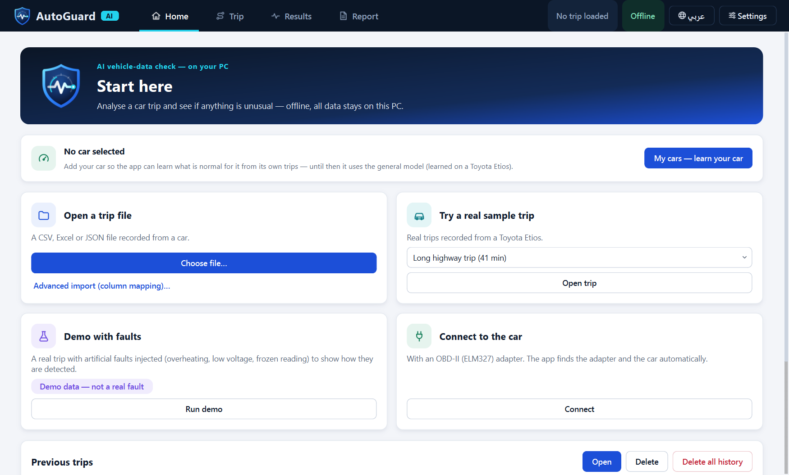

# AutoGuard AI: Offline Vehicle Telemetry Analysis & Anomaly Detection

Educational Windows desktop prototype (Computer Science graduation project). It analyses car trips,
either **recorded files** or **live from an OBD-II adapter**, and explains in plain **Arabic or
English** whether anything looks unusual, what is normal for the car, what it may mean and what to
do. It runs fully offline, and all data stays on the PC.

> Not a diagnostic or safety system. Findings are evidence-based observations, not fault diagnoses.
> Real-world fault-detection performance is unknown because no trustworthy fault labels were available.

**Explaining the project (Arabic, for the defence):** [docs/PROJECT_EXPLAINED_AR.md](docs/PROJECT_EXPLAINED_AR.md)

## Quick start

1. On Windows, install Python 3.11 and clone this repository.
2. Run the setup script once (internet is required to install dependencies and download model weights):

   ```powershell
   powershell -ExecutionPolicy Bypass -File setup.ps1
   ```

   For a CPU-only install, use `setup.ps1 -Cpu`.
3. Start the app:

   ```powershell
   .venv\Scripts\python run.py
   ```

   Or launch the packaged build with `dist\AutoGuardAI\AutoGuardAI.exe`.

The app itself works offline after setup. Try a bundled real sample or the clearly-labelled fault
demo from the Home screen; no external dataset is needed for normal use.

## Requirements

- Windows 10/11 (the tested environment was Windows 11)
- Python 3.11 for running from source
- About 8 GB RAM recommended; the packaged application is large because it includes PyTorch
- NVIDIA GPU with CUDA 12.6 is recommended for the fastest setup and analysis, but a CPU-only
  setup is available with `setup.ps1 -Cpu`
- Internet access is needed once for dependencies and the pinned MOMENT model weights; trips remain
  local and the application does not require an online service

## The app (4 screens, Arabic/English, "Black Box" identity)

**Advanced analysis:** Results → Advanced analysis opens sensor-graph analysis, multi-horizon
probabilistic forecasts, active PID acquisition, synchronized WAV/accelerometer/OBD fusion,
and file-based federated model training. See [usage, validation and limits](docs/ADVANCED_ANALYSIS.md).
These research tools have separate results; they do not silently change the primary vehicle verdict.

| Screen | What it does |
|---|---|
| **Home** | Open a file, a real sample trip, the demo with injected faults, or **Connect to the car**. Previous trips. |
| **Trip** | Replay with large live values and charts. Findings are shaded. "Show on chart" jumps to a finding. |
| **Results** | Colour-coded verdict, trip summary, and every finding explained: *what happened · what is normal · what it may mean · what to do · how we know* (+ confidence). |
| **Report** | PDF in Arabic or English, findings CSV, data CSV. |

Technical details (detector table, scores, thresholds), advanced column mapping and settings are in
dialogs, out of the way.

Brand and UI: the logo, colours, icons and components are documented in
[docs/DESIGN.md](docs/DESIGN.md), with the matching Figma file. The same logo is used for the EXE icon,
the window and the PDF header.



## How a trip is checked (4 methods)
| Method | Role | Trained here? |
|---|---|---|
| Limit rules (coolant, charging voltage, RPM, frozen reading) | clear, configurable | no |
| **Expected vs actual** (primary model) | learns from normal trips what each reading *should* be, then compares | yes, under 1 min |
| Isolation Forest | finds unusual moments | yes |
| MOMENT-1-small (pretrained foundation model) | second opinion, strong on voltage | no (threshold only) |

Alerts from all methods are merged into **findings** with a confidence level (`ai/explain.py`).

## Results snapshot

The full methodology, partitions, confidence intervals and detector-by-detector results are in
[docs/EVALUATION.md](docs/EVALUATION.md). The headline results are:

- On 26 held-out Toyota Etios trips (8.8 h), the primary expected-vs-actual model produced
  **0.57 false alerts/hour** on assumed-normal data.
- In the synthetic stress test, it detected **25/25 overheat**, **26/26 voltage-drop**, and
  **26/26 coolant sensor-step** injections. These are software injections, not real-fault accuracy.
- The consistency checks detected **26/26 sensor-step** and **26/26 silent-sensor** injections while
  remaining silent on the clean held-out trips.
- On 132 unseen VED cars, learning each car reduced false alerts from **1.1 to 0.2/hour**; an
  unlearned car is intentionally kept out of the primary verdict.

MOMENT is retained as a second opinion. Its zero-shot reconstruction is useful for some voltage
changes but misses slow drifts and frozen values; the adapted experiment is documented in
[MODEL_CARD](docs/MODEL_CARD.md), not used in the app.

## Latest results (updated 2026-11-02; see [EVALUATION §H](docs/EVALUATION.md))

The original Toyota benchmark was executed on 2026-10-22/23. Section H contains the later
multi-car and frozen-sensor evaluation executed on 2026-11-02; dates are kept explicit so results
from different runs are not mixed.

- **Toyota test trips:** the app catches 100 % of injected overheat, voltage drop, frozen RPM (was 58 %),
  sensor step and silent sensor. Noisy speed: 65 %. False alerts on normal trips: 0 from rules and
  checks, 0.57/h from the model.
- **132 unseen VED cars:** false alerts 25.3 → 0.73/h before learning the car and 1.1 → 0.2/h after.
  Frozen RPM caught 99.6 %.
- **How:** 320 h of clean data from 132 other cars, split by car with leakage checks, and a frozen-sensor
  check with limits from training data. No overfitting gap: the error is 143 rpm on training cars and
  142 rpm on unseen cars.
- **Still weak:** an RPM sensor that is offset but still moving (6 %). No real labelled faults exist.

## Tested on other real cars (EVALUATION §G)
- The models were trained on one Toyota. On real logs of **107 other cars** (VED, 507 h), a Ford Focus
  and a Chrysler Pacifica, the base model raised **12–58 false alerts/h**. It does not transfer as is.
- **With "learn your car"** it drops to **1.1/h** (VED, 90 of 107 cars below 1/h) and **0.26/h**
  (Ford). The price: RPM sensor faults are rarely caught on those cars.
- So on a car that has not been learned, the model's findings are now shown as low confidence and kept
  out of the verdict.
- The app picks a full or an RPM + speed model from the sensors in the file.
- Hybrids get an engine-type setting, because their engine stopping while driving is normal.
- New **impossible-reading check** for RPM, MAF and baro. Its limits come from Toyota + VED dev data.
  It raised 0 alerts on 3,195 h of held-out real driving, and caught 10 of 11 RPM/MAF/baro glitches in
  a real Ford log.

## New in v0.3
- **Is the car sick, or is the sensor lying?** Physical consistency checks with thresholds derived
  from all 129 real trips (0 alerts on all of them). Findings are split into "the car" vs "reading
  reliability".
- **Learn your car:** approve normal reference trips. The base model is adapted to that car (evidence
  gate, learned offsets and the car's own noise margin). Simulated different car: 5.2 → 0.71/h; real
  other cars: see above. [EVALUATION §F, §G](docs/EVALUATION.md).
- **Scenario lab + what if?:** inject a fault into a copy of a trip and see which method finds it
  and when (e.g. a gradual voltage decline was found by the model ~100 s before the fixed rule), or
  ask "what if this sensor had stayed normal?".
- Fixes from a user review: results tied to their own trip, partial-check verdicts, warnings never
  hidden by short trips, monotonic OBD time after reconnect, NaN-safe time ordering.

## Status
| Feature | Status |
|---|---|
| CSV / XLSX / JSON import, mapping editor, unit conversion, quality report | ✅ tested |
| Replay, findings, explanations (AR/EN), history, PDF (AR/EN) / CSV | ✅ tested |
| Live OBD-II: auto-detect adapter, VIN, supported signals, stored DTCs (read-only), record & analyse | ✅ simulated adapter + mocks. ⚠️ **not yet tested on a real car** ([plan](docs/FUTURE_OBD_INTEGRATION.md)) |
| Named fault classification | ❌ disabled. No dataset supports it defensibly ([why](docs/DATASET_AUDIT.md#3-dieselobd)) |
| Vehicle Health % | ❌ intentionally not computed (no ground truth) |
| Windows EXE (PyInstaller onedir) | see [docs/OFFLINE_TEST.md](docs/OFFLINE_TEST.md) |

## Run
```powershell
powershell -ExecutionPolicy Bypass -File setup.ps1     # venv, deps, pinned MOMENT weights, tests (internet once)
.venv\Scripts\python run.py                            # or dist\AutoGuardAI\AutoGuardAI.exe
```
Tests: `.venv\Scripts\python -m pytest -q` ([log](docs/test_log.txt)). Build:
`.venv\Scripts\pyinstaller packaging\autoguard.spec --noconfirm`. Headless check:
`AutoGuardAI.exe --selftest <dir>`.

## Data
carOBD Toyota Etios 2014 (129 trips, 41.7 h): **accepted**. Used for training, calibration, held-out
test and demo samples. VED (384 cars, 4,855 h, Apache 2.0) and APMonitor Ford/Chrysler logs (no
license stated, not bundled): **cross-car validation only**. DieselOBD and Scania APS: **restricted**
(reasons in the audit). KIT: needs manual download (terms). Evidence: [docs/DATASET_AUDIT.md](docs/DATASET_AUDIT.md). Licenses:
[ATTRIBUTION.md](ATTRIBUTION.md).

## Layout
```
app/        PySide6 UI: pages (home, trip, results, report, live, settings, tech details), i18n, theme, icons, assets (logo)
ai/         rules, expected-vs-actual, Isolation Forest, MOMENT, thresholds, pipeline, explain
core/       schema, mapping, sources (files, synthetic demo, OBD, simulated adapter), validation, replay
database/   SQLite migrations + repositories        reporting/  PDF (AR/EN) + CSV
experiments/ audit, training, calibration, adaptation, evaluation, sanity check
models/     iforest/, normal_behavior/, moment-1-small/ (pinned weights provisioned by setup)
```

## Known limitations
Models are trained on one car; on other cars they need "learn your car", and then RPM faults are
hard to see. No real fault labels anywhere. Catalyst-temperature glitches are not checked; an RPM
glitch smaller than the largest real 1-s change (4,568 rpm) is not seen. Live connection not yet tested on a real car. carOBD redistribution
terms are informal. The EXE is large (CUDA PyTorch).
